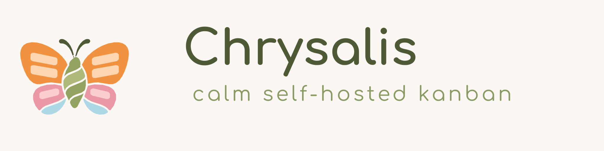
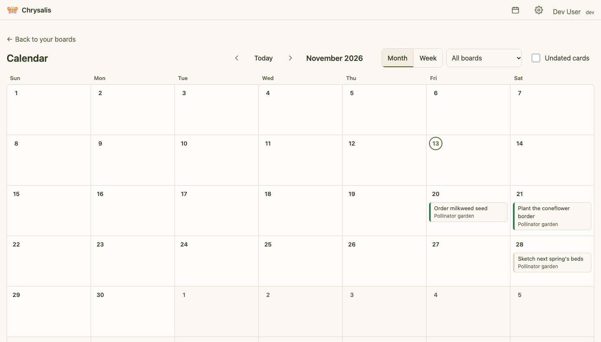

<p align="center">
  <picture>
    <source media="(prefers-color-scheme: dark)" srcset="docs/images/banner-dark.svg">
    
  </picture>
</p>

# Chrysalis

A calm, self-hosted kanban board designed to reduce visual and cognitive load. Everything collapses, nothing is lost,
and what you see is what you chose to see.

Most board tools show everything at once: every card's labels, dates, checklists and counts, in bright colors, with
red badges for whatever is late. Chrysalis starts from the other end. Cards are a single line until you open them, the
colors are soft, nothing moves unless you moved it, and there is no guilt: no overdue badges, no counts of what you
haven't done, and an Undo for everything instead of "are you sure?".


## Status

**In daily use, in a household trial.** Everything in the design's first phase is built and deployed: boards, cards and
their details, the overwhelm controls, themes, live sync, offline viewing, backups and the Trello import. The second
phase is under way: the calendar view and in-app reminders are done; push notifications, custom fields and sharing
come next. What's planned and why is in the [design document](docs/DESIGN.md#4-feature-scope-by-phase).

Releases are tagged `vX.Y.Z`, and each one publishes a multi-architecture container image to
`ghcr.io/runlevel-six/chrysalis`.

## What it does

**Calm by default**

- **Three ways to see a card:** a single line, expanded in place, or a full view, each remembered per person and synced
  to every device you use.
- **Overwhelm controls:** collapse or expand everything, collapse a column to a narrow strip, focus on one column, hide
  what's done, and filter by title or label.
- **Forgiving:** everything saves as you go, every change can be undone, and deleted things wait in the trash for 30
  days.
- **Quiet details:** labels, dates and checklist progress stay off collapsed cards unless you turn them on. Overdue
  highlighting is off unless you want it.

**Everything a board needs**

- Columns with colors, soft limits that never block, and "done" columns that finish the cards dropped in them.
- Cards with rich descriptions and inline images, labels, start and due dates, several checklists, attachments and
  links, covers, and an archive.
- Drag and drop, including with the keyboard and on touch screens, plus "Move to…" (also to another board) and move
  up or down.
- Board backgrounds (colors, gradients or your own photo), icons, templates, archive and trash.

**Around the board**

- A **calendar** of due dates across one board or all of them, with drag to reschedule and a panel of undated cards.
- **Reminders** that are opt-in twice (in Settings, then per card), gently worded, and snoozable.
- A **centering line**: an optional, quiet line of Scripture or quotes you choose, under the board's title.
- **Live sync** between tabs and devices, and **offline viewing** of the boards you've opened, installable on a phone's
  home screen.
- **Themes:** Default and Butterfly Garden, each light and dark, checked against WCAG AA contrast; deployments can
  add their own themes, icon and name.
- **Trello import** of boards, lists, cards, labels, checklists, dates and comments.



## Try it

To see it on your own computer in a minute, with no sign-in (dev mode, for trying only):

```sh
docker run --rm -p 127.0.0.1:8080:8080 \
  -e CHRYSALIS_BASE_URL=http://localhost:8080 \
  -e CHRYSALIS_AUTH_MODE=dev -e CHRYSALIS_DEV_MODE=true \
  -v chrysalis-try:/data \
  ghcr.io/runlevel-six/chrysalis:latest
```

Then open <http://localhost:8080>. The [tutorial](docs/tutorials/try-chrysalis.md) walks through a first board.

## Run it for your household

Chrysalis is one container with one volume: a SQLite database and attachment files. Run it behind HTTPS, with one of
two ways to sign people in:

- **OIDC:** Chrysalis signs people in through your identity provider. Recommended.
  [Set it up](docs/how-to/sign-in-with-oidc.md).
- **Forward-auth:** a reverse proxy that already authenticates people passes their identity in headers, trusted only
  from the proxy. [Set it up](docs/how-to/sign-in-behind-a-proxy.md).

Deployment files for Docker Compose are in [`deploy/compose`](deploy/compose), and for Kubernetes (a Kustomize base,
example overlays and a backup CronJob) in [`deploy/k8s`](deploy/k8s). Then [turn on backups](docs/how-to/back-up-and-restore.md)
before you put anything important in it.

## Documentation

The [documentation index](docs/README.md) has reading paths for each kind of reader. Highlights:

| | |
| --- | --- |
| Getting started | [Try Chrysalis on your computer](docs/tutorials/try-chrysalis.md) |
| Running it | [Sign in with OIDC](docs/how-to/sign-in-with-oidc.md) · [Sign in through a proxy](docs/how-to/sign-in-behind-a-proxy.md) · [Back up and restore](docs/how-to/back-up-and-restore.md) · [Import from Trello](docs/how-to/import-from-trello.md) · [Set up the centering line](docs/how-to/set-up-the-centering-line.md) |
| Reference | [Configuration](docs/reference/configuration.md) · [Branding](docs/reference/branding.md) · [Keyboard shortcuts](docs/reference/keyboard-shortcuts.md) · [Centering line files](docs/reference/centering-line-files.md) |
| Background | [Design document](docs/DESIGN.md) · [How sync and offline work](docs/explanation/sync-and-offline.md) · [How backups work](docs/explanation/backups.md) · [Decision records](docs/adr/) |

## How it's built

- **Server:** Go, a single static binary with the web app embedded. SQLite (pure Go, in WAL mode) with migrations,
  sqlc for queries, server-sent events for live sync.
- **Web app:** React and TypeScript, built with Vite. TanStack Query for data, dnd-kit for drag and drop, TipTap for
  descriptions.
- **Security:** a strict Content Security Policy, cross-site request protection, sessions stored only as hashes,
  attachments served only to board members with metadata (including GPS) stripped from photos.
- **Accessibility:** keyboard operation throughout, screen-reader announcements for drag and drop, 44-pixel targets,
  and axe checks in every end-to-end test run.

## Development

You need Go and Node. Then:

```sh
make hooks     # once per clone: pre-commit checks (private-data denylist, betterleaks)
make dev       # the server on :8080 as a fixed dev user, data in ./data
make web-dev   # alongside it: the web app with hot reload on :5173
make test      # Go tests with the race detector
make e2e       # the Playwright + axe suite against a fresh build
make lint      # golangci-lint
```

`docs/DESIGN.md` is the source of truth for what to build and why, and decisions made along the way are recorded in
[`docs/adr`](docs/adr). CI runs lint, tests, vulnerability and license checks, a secret scan and the end-to-end suite on
every push.

## A note on sensitive data

If you store sensitive information in Chrysalis, securing it is up to you: how and where the data is stored, backed
up, encrypted and accessed in your deployment is your responsibility. See the Apache-2.0 license for the full warranty
disclaimer.

## License

Apache-2.0. See [LICENSE](LICENSE) and [NOTICE](NOTICE).
